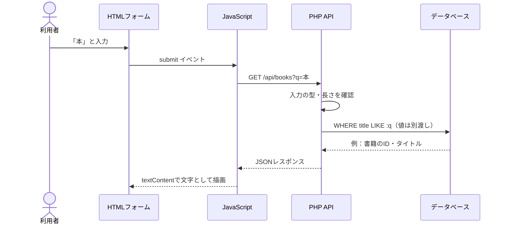

# 特別講義01：HTML → JavaScript → PHP → SQL → 画面表示を1本の線で追う

> **読解用の仮想システムです。** すべて部分コード。サーバー起動や操作は不要です。

## 例題

ある人が「本」というキーワードを検索する。ブラウザで入力した文字は、どの場所を通って結果画面に現れるのでしょうか。



## 1. HTML：値の入口

```html
<form id="search-form">
  <label for="query">書名</label>
  <input id="query" name="q" maxlength="60">
  <button type="submit">探す</button>
</form>
<ul id="results"></ul>
```

- `id` はJavaScriptから対象を見つける印。
- `name="q"` は送信データの名前。
- `maxlength` は入力を助けるが、サーバーの検証を代行しない。
- `ul` は検索結果を表示する場所。表示内容はまだ空。

## 2. JavaScript：要求の組み立て

```javascript
const form = document.querySelector('#search-form');
const resultList = document.querySelector('#results');

form.addEventListener('submit', async (event) => {
  event.preventDefault(); // ブラウザの既定のフォーム送信を止める
  const query = document.querySelector('#query').value;
  const response = await fetch('/api/books?q=' + encodeURIComponent(query));
  if (!response.ok) throw new Error(`HTTP ${response.status}`);
  const items = await response.json();
  resultList.replaceChildren();
  for (const item of items) {
    const li = document.createElement('li');
    li.textContent = item.title; // 文字列はHTMLとして解釈させない
    resultList.append(li);
  }
});
```

**注目する行：** `encodeURIComponent` はURLに値を入れる際の符号化であり、SQLインジェクション対策やXSS対策ではありません。`textContent` は表示時にHTMLとして解釈されるのを防ぐのに有用です。エラーを画面に伝える処理やタイムアウト等は省略しています。

## 3. PHP：信頼境界

```php
<?php
// 説明用：$pdo はすでに安全に作成されたDB接続とする
$query = $_GET['q'] ?? '';
if (!is_string($query) || mb_strlen($query) > 60) {
    http_response_code(422);
    exit;
}
$stmt = $pdo->prepare('SELECT id, title FROM books WHERE title LIKE :q LIMIT 20');
$stmt->execute([':q' => '%' . $query . '%']);
header('Content-Type: application/json; charset=utf-8');
echo json_encode($stmt->fetchAll(PDO::FETCH_ASSOC), JSON_UNESCAPED_UNICODE);
```

**行ごとに追う：**

1. `$_GET['q']` は利用者が変更できる値。**信頼しない**。
2. `is_string` と `mb_strlen` で型と長さを判定。`mbstring` 拡張を前提にした例。
3. `prepare` はSQLの命令部分を固定。
4. `execute` は値だけを束縛する。ただし `%` と `_` を検索文字として扱うにはLIKE用のエスケープも考慮する必要がある。
5. `json_encode` はPHPの配列をJSON形式に直す。SQLやHTMLの安全性そのものを保証するものではない。

## 4. DB：問い合わせの意味

```sql
SELECT id, title
FROM books
WHERE title LIKE :q
LIMIT 20;
```

`SELECT` は取り出す列、`FROM` は対象テーブル、`WHERE` は抽出条件、`LIMIT` は行数の上限。検索の条件を作るのと「この利用者がその書籍を見てよいか」は別問題です。非公開データなら認可条件を追加します。

## 5. まとめ：各レイヤーの防御は置き換えられない

| 行うこと | どこで？ | 対応する危険 |
|---|---|---|
| 入力の意味・長さを検査 | PHP | 予想外の値や過大入力 |
| SQLの値を束縛 | PDO | SQL命令の改変 |
| 所有者を照合 | PHP / DB問い合わせ | IDOR・認可の不備 |
| textContentで表示 | JavaScript | HTMLの意図しない解釈 |
| HTTPステータスを判定 | JavaScript | エラーを正常と誤認 |

**自問：** `textContent` を採用したので `prepare` は省略できる？ → **いいえ。** 表示とデータベースでは異なる信頼境界を守っています。
