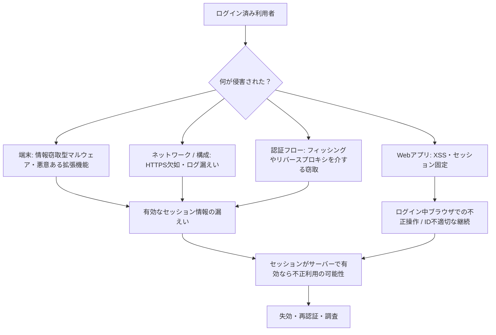
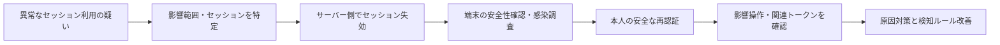

# 特別講義06：Cookie窃取・セッションハイジャックを基礎から応用まで

**深く学びたい方：** [Cookie・セッション完全読本（20講義）](../textbooks/02-cookie-session-textbook.md)／[Web版](../docs/cookie-book.html) も併せてご覧ください。


> **READ & REASON / 読解専用・実行不要**  
> 確認日：**2026-10-20**。すべてのセッションIDは架空のラベルで、実際のログイン情報は含まない。本講義はHTTPリクエストを送信しない。反例のコードは**決して実サービスに使用しない**こと。

**学習対象：** 初心者／Web開発者／SOC・CSIRT／セキュリティ設計者  
**到達目標：** ① Cookieとセッションの関係を追える ② 乗っ取りの経路を区別できる ③ コードとHTTPヘッダーの危険を見抜ける ④ 多層防御と侵害対応を説明できる ⑤ 対策の限界を誤解しない。

---

## 01｜30秒で理解する：Cookieは「会員証」ではなく「通行証」

- **認証**：利用者がパスワード・パスキー・MFA等で本人確認する行為。
- **セッション**：認証後の状態を、複数のHTTP要求にわたって維持する仕組み。
- **セッションCookie**：ブラウザが送る、通常はランダムで意味のないセッション識別子。サーバーが識別子からログイン済みの状態を引き当てる。
- **セッションハイジャック**：正規利用者の有効なセッションを、他者が不正利用すること。
- **Cookie窃取**：その侵害経路の一つ。すべてのCookieが認証に使用されるわけではない（言語・テーマの設定Cookieなどもある）。

> **講師ナレーション：** 「パスワードは入口で本人を確認するものです。セッションCookieは、認証の後、毎回本人確認しなくても操作を続けるための識別子です。これが第三者に渡ると、設計によってはパスワードも二段階認証も使わずに、今あるログイン状態を不正利用されます。」

### 読むだけの通信図

```mermaid
sequenceDiagram
    participant B as ブラウザ（本人）
    participant W as Webアプリ
    participant S as セッション保存先
    B->>W: ログイン（本人確認）
    W->>S: ランダムなIDとユーザー情報を関連付け
    W-->>B: Set-Cookie: __Host-session=[架空ID]; Secure; HttpOnly; Path=/; SameSite=Lax
    B->>W: 後続の閲覧要求 + Cookie: __Host-session=[架空ID]
    W->>S: IDの有効性・失効・期限を照合
    S-->>W: 該当ユーザーのセッション状態
    W-->>B: 権限に応じた応答
```

**観察する境界：** `Set-Cookie` は**サーバー→ブラウザ**、`Cookie` は**ブラウザ→サーバー**。サーバーがCookieの値を本人と関連付ける設計なら、**その値を保持すること自体がアクセス権になり得る**（Bearer Credential）。[R1][R2][R3]

---

## 02｜混同しない：Cookieとセッション情報とトークン

| 用語 | 置かれる場所・役割 | 重要な注意 |
|---|---|---|
| Cookie | ブラウザが保存し、対象URLへの要求で送る名前と値 | セッション用途かどうかはアプリ設計による |
| サーバー側セッション | Redis/DB/メモリ等に保存するログイン状態 | IDの検証・期限・失効はサーバー側で実施する |
| セッションID | セッションを探すための高エントロピーな秘密値 | 値を知っただけで利用できる方式が一般的 |
| JWT | クレームを持つ署名付きトークンの一形式 | JWT自体がCookieではない。CookieにもAuthorizationにも格納され得る。暗号化されていないJWTのペイロードは通常読める |
| アクセストークン | APIへアクセスするためのトークン | 送信先・権限・有効期間・失効方法を考える |
| リフレッシュトークン | アクセストークンを取得し直すための資格情報 | 長期間利用され得るので保存・失効・ローテーションが重要 |
| パスキー・MFA | ログイン時の本人確認を強化 | 盗難済みの有効セッションを常に無効化するわけではない |

**誤解1：「Cookieにはパスワードが書いてある」** → 通常、セッションCookieにパスワードを格納すべきではない。  
**誤解2：「JWTなら盗まれない」** → 署名付きBearer JWTも有効なまま奪われれば再利用され得る。  
**誤解3：「ブラウザを閉じる＝ログアウト」** → セッション復元などがあるため、サーバー側で失効・期限を必ず管理する。[R1][R3]

---

## 03｜「盗む」と「使わせる」は別：攻撃経路マップ



### 脅威別の根本原因と限界

| 経路 | 何が原因？ | よくある誤解 | 防御の主眼 |
|---|---|---|---|
| XSS | 未信頼文字列がHTML/JSの命令として扱われる | `HttpOnly`ならXSS被害ゼロ | 文脈別エスケープ、危険なDOM API回避、CSPなど。HttpOnlyは**Cookieの読取**を抑えるが**同一ブラウザ上の不正操作**を防がない [R4] |
| 情報窃取型マルウェア | 端末/ブラウザの侵害 | `Secure; HttpOnly`で端末感染にも対抗できる | 端末保護、拡張管理、セッション失効、可能ならデバイス結合 [R6] |
| HTTPS設定ミス | 盗聴・改ざんされ得る経路 | ログイン画面だけHTTPSで十分 | サイト全体のHTTPS、Secure、HSTS [R2][R3] |
| セッション固定 | 認証前からあるIDを認証後も受容 | ランダムIDなら再生成不要 | 認証成功・権限変更で再生成し古いIDを無効化 [R3] |
| ログ・URL漏えい | セッションIDをURL/ログ/解析ツールへ出す | ログは社内なので秘密でない | URLにIDを置かない、Cookieヘッダーを記録しない [R3] |
| フィッシング系 | 利用者の認証フローが偽装・中継される | MFAを入れればすべて無効 | 耐フィッシング性の高い認証とセッション保護を**別々に**設計 [R1][R5] |
| CSRF | ブラウザがCookieを自動添付する | Cookie窃取と同じ | 操作意思を確認するCSRFトークン/Origin検証など。**窃取がなくても起こる** [R8] |

※ 攻撃の経路を理解するための概念図であり、Cookieの抽出・中継・再利用手順は載せない。

---

## 04｜HTTPヘッダーを読む：安全な設定と危険な設定

### 反例：読める・共有され得る・期限が長すぎる（教材断片）

```http
HTTP/1.1 200 OK
Set-Cookie: session=[架空の識別子]; Domain=example.test; Path=/; Max-Age=2592000
```

- `Domain=example.test`：サブドメインまで適用範囲が広がる。業務上必要な場合以外は指定しない。
- `Max-Age=2592000`：30日。サーバー側で時間制限がなければ、漏えい時に悪用できる期間が長い。
- `Secure` 不在：セキュアでない送信を制限しない。
- `HttpOnly` 不在：JavaScriptから読み取られ得る。
- `SameSite` 不在：ブラウザ既定値任せ。明示するほうが意図が伝わる。

### 改善例：権限を狭くする（架空の識別子）

```http
HTTP/1.1 200 OK
Set-Cookie: __Host-session=[架空の識別子]; Path=/; Secure; HttpOnly; SameSite=Lax
```

**1行読解：**

- `__Host-`：対応ブラウザで `Secure`、`Path=/`、**Domainなし**のルールを強制する。
- `Secure`：原則HTTPS接続に送信を限定（localhostにはブラウザ例外がある）。
- `HttpOnly`：`document.cookie` などのJavaScript APIで読めなくする。`fetch` を通じた認証付きリクエスト自体を妨げるわけではない。
- `SameSite=Lax`：サイトをまたぐ要求でのCookie送信を一部抑える。`Strict`は強いが外部リンクからの遷移などの使い勝手に影響する。
- `SameSite=None`は**制限なし**という意味で、利用には`Secure`が必要。
- `Partitioned` (CHIPS) は埋込みなどでの**Cookie分割**を目的とする。盗まれたセッションが万能に無効化されるわけではない。
- `Path`や`Domain`は権限認可の代わりにはならない。

**大切な境界：** 属性だけでセッション有効期間は確定しない。**サーバー側で絶対期限・アイドル期限・失効を管理する**。[R1][R2][R3]

### 属性ごとの「できる／できない」

| 属性 / 設計 | できる | できない |
|---|---|---|
| `Secure` | 平文HTTPへのCookie送信を制限 | 端末内マルウェアを消す |
| `HttpOnly` | JS APIによるCookie取得を制限 | XSSが認証済み画面内で操作することを防ぐ |
| `SameSite` | CSRFの一部を軽減 | 別端末での盗難Cookie使用を禁止する |
| `__Host-` | Cookieの適用ドメインを狭める | 盗難Cookieの単純な再利用を防ぐ |
| `Partitioned` | 埋込み元サイトごとにサードパーティCookieを分離 | ログイン済みセッションの窃取を防ぐ |
| IDローテーション・強制失効 | 古いIDの有効期間を短縮・終了 | 現に進行中の不正操作を事後的に消す |
| デバイス結合（適用時） | 盗難した識別子だけの外部再利用を困難に | 端末内部での不正操作、すべての経路を阻止 |

---

## 05｜PHPを行ごとに理解する：セッション固定と安全な発行

### 反例：ログイン成功後も以前のIDを維持

```php
// 教材用反例：この断片をアプリに組み込まない
session_start();
if ($passwordIsVerified) {
    $_SESSION['user_id'] = $userId;
    // 認証前のIDを認証後も継続 → セッション固定の懸念
}
```

**なぜ危険？** 認証前のセッションIDを攻撃者が別の欠陥により知っていたり設定させられたりした場合、認証後も同一IDが権限を持つ可能性がある。[R3]

### 改善：設定 → セッション開始 → 認証成功時の切替

```php
// 説明用の抜粋。HTTPS終端、セッション保存先、失効を別途設計する
ini_set('session.use_strict_mode', '1'); // 未発行IDを受け入れない
ini_set('session.use_only_cookies', '1'); // URL経由のSIDを使わない
session_name('__Host-session');
session_set_cookie_params([
    'path' => '/',
    'secure' => true,
    'httponly' => true,
    'samesite' => 'Lax',
]);
session_start();

if ($passwordIsVerified) {           // 認証ロジックは別途必須
    session_regenerate_id(false);    // IDを変更。古いIDの期限・失効を別途管理
    $_SESSION['user_id'] = $userId;  // 認証済み主体をサーバー側に保存
}
```

**行単位の意味**

1. `use_strict_mode`：サーバーが未発行のセッションIDを採用しにくくする。
2. `use_only_cookies`：セッションIDをURLに流さない。
3. `__Host-`：Cookieの属性制約をブラウザにも検証してもらう。
4. `Secure`：HTTPS前提でCookieを送信する（開発用HTTP環境では正常動作しないことがある）。
5. `HttpOnly`：JavaScriptによる閲覧を抑える。
6. `SameSite=Lax`：一部のクロスサイト要求に添付させない。
7. `regenerate_id(false)`：ログイン前のIDを認証後のIDとして使い続けず、古いIDの扱いは期限・失効処理で制御する。
8. `$_SESSION`：サーバー側の状態としてユーザーIDを保持する。

**このコードでも不足すること：** セッションIDの安全な保存、分散環境での失効連携、絶対・アイドルタイムアウト、ログアウト、CSRF、XSS対策、MFA、権限変更時の再認証。`session_regenerate_id()` の実運用では通信競合や旧IDの無効化時期・ストレージ挙動への配慮も必要。[R3][R9]

---

## 06｜JavaScriptで見えるCookieと見えないCookie

```javascript
// あくまで仕組みを読む説明コード
const visible = document.cookie;
// HttpOnlyのセッションCookieはここに表示されない。
// ただし、同じページの認証済み操作が安全になるわけではない。
```

```javascript
// 安全なDOM操作の基本：文字列をHTMLコードとして解釈させない
const label = document.querySelector('#welcome');
label.textContent = userSuppliedDisplayName; // 文字列として表示
```

**危険な対比：**

```javascript
// 反例：未信頼データをHTMLとして解釈させる
label.innerHTML = userSuppliedDisplayName;
```

`textContent`が防ぐのは、この表示箇所でのHTML/JS混入。URL、属性、CSS、JavaScript文字列など文脈が違えば別の対策が必要。`HttpOnly`はXSS全般の解決策ではない。[R4]

---

## 07｜セッション盗難が疑われるときの追跡：読むだけのイベント表

以下は**全て架空の監査データ**。Cookie値、秘密鍵、パスワードは記録しない。

| 時刻 | セッション別名（疑似化） | イベント | 信号 | 初期判断 |
|---|---|---|---|---|
| 09:00 | `S-A1` | `login_success` | 通常の端末・地域 | 正常 |
| 09:10 | `S-A1` | `resource_view` | 通常の経路 | 正常 |
| 09:11 | `S-A1` | `resource_view` | 端末特性が大幅に変化 | 要確認 |
| 09:12 | `S-A1` | `high_risk_change_attempt` | 急な操作 + 端末特性変化 | 制限・再認証候補 |
| 09:13 | `S-A1` | `session_revoked` | セッションをサーバー側で失効 | 以後アクセス拒否 |

**なぜ誤検知がある？** 端末のOS更新、移動中の回線切替、企業VPN、プロキシ、時差、ブラウザ設定変更などでも特性が変わる。逆に同じIPやUAでも安全とは言えない。[R1][R5]

### 守る側の疑似判定コード（実行する必要なし）

```text
イベントを受け取る
  ↓
セッションはサーバー側で有効か？ → No: 拒否
  ↓ Yes
端末/位置/時刻/操作の変化を複合的に評価
  ↓
通常の閲覧なら継続監視
高リスク操作 + 不審な変化なら一時停止 → 既存セッションを失効/制限
  ↓
登録済みの認証手段で再認証 → 新しいセッションを発行
  ↓
監査ログを確認し関係セッションにも調査を拡大
```

**ログ設計の鉄則：** 生の `Cookie:` / `Set-Cookie:` ヘッダーを保存しない。セッションの相関が必要なら、漏えいしても資格情報として使えない疑似IDや適切に管理されたHMAC識別子を検討。保管期間・アクセス制御・監査・個人情報への配慮を設計する。[R3][R5]

---

## 08｜利用者・開発者・SOCで異なる対処

| 役割 | 最優先の行動 | 注意 |
|---|---|---|
| 利用者 | 公式のセキュリティ画面でセッション一覧確認、「全端末からログアウト」、端末の安全性確認、疑わしい拡張機能を見直す | **パスワード変更だけでは既存セッションが失効するとは限らない**。利用サービスの仕様を確認 |
| 開発者 | サーバー側の失効、短い有効期間、Secure/HttpOnly/SameSite、ログイン時ID再生成、XSS対策、認可 | 属性設定だけで十分と判断しない |
| SOC/CSIRT | セッション寿命のイベント分析、端末感染兆候、異常アクセス、高リスク操作の関連付け | IP変化のみで侵害確定としない。証跡とプライバシー配慮を両立 |
| 運用設計者 | 失効機構のテスト、段階的再認証、権限変更時の見直し、アラート品質向上 | 重要操作の確認をCAPTCHAで代用しない [R5] |

### インシデントの流れ（例）



感染した端末のまま新しい認証情報を発行すると再窃取の可能性がある。サービスによってはセッション失効だけでなく、APIトークン、リフレッシュトークン、連携アプリや認証手段の見直しが必要。

---

## 09｜2026年の追加テーマ：DBSCと「デバイス結合」

従来のBearer Cookieは**持っているだけで利用可能**な場合がある。DBSC（Device Bound Session Credentials）は、ブラウザが保持するデバイス結合の秘密鍵を使って、短命なCookieの更新時に**その端末が鍵を保有していることを証明**する方向の仕組み。単純にCookie文字列を外へコピーしただけでは継続利用しにくくする。[R5][R6][R7]

```text
従来：Cookieを持つ → 有効期限内なら受け入れられ得る
DBSC：短命Cookie + 端末内の鍵による更新時証明 → Cookie文字列だけの長期再利用を抑える
```

**エビデンスの粒度を分けて読む：**

1. **技術仕様：** W3CのDBSC文書は標準化作業中のWorking Draft。[R7]
2. **製品展開：** Googleは2026年4月9日、Chrome 146（Windows）での一般提供への移行と、macOSへの今後の展開予定を発表した。[R6]
3. **効果の限界：** Webサイト/ブラウザ/OS/アカウントの対応範囲に依存する。端末上で活動中のマルウェアが利用者の操作環境を悪用する問題が完全消滅するわけではない。**Chromeを使えばすべてのサービスで自動的に安全、という意味ではない。**
4. **別製品：** Microsoft EntraのToken Protectionはデバイス結合トークンに関する別の製品機能であり、Cookie全般に自動適用される仕組みとは同一視しない。[R10]

---

## 10｜発展：攻撃境界と防御境界の対応づけ

| 信頼境界 | 脅威モデル | 優先する対策 | 観測可能な痕跡 |
|---|---|---|---|
| ブラウザ画面と外部入力 | XSS | 安全なDOM API・文脈別エスケープ・CSP | CSP違反、意図しないDOM変更（万能ではない） |
| ブラウザ保存領域と端末 | Infostealer | 端末保護・拡張審査・セッション失効 | EDRアラート・異常なセッション使用 |
| HTTP通信とネットワーク | 通信の盗聴・改ざん | HTTPS/TLS、HSTS、Secure | HTTP接続の発生、TLS異常 |
| セッションIDとサーバー状態 | 再利用・固定・失効漏れ | 高エントロピーなID・厳格受容・再生成・短い期限・失効 | 同じ疑似セッションIDの異常なアクセスパターン |
| 認証状態と権限 | 認可漏れ・権限昇格 | 各操作で認可、重要操作は再認証 | 許可されない資源への要求や権限変更 |
| ログ・解析基盤 | セッション情報の二次漏えい | 機密値削除・疑似化・アクセス制御 | 生Cookieを含むログを検出した場合は是正 |

### サーバー側で「期限」「失効」を管理するイメージ

```text
sessions（概念的な保存レコード）
  sid_verifier = 「秘密IDを検証するための値」
  user_id      = 本人を示す内部ID
  created_at   = 発行日時
  last_seen_at = 最終操作
  expires_at   = 絶対期限
  revoked_at   = 失効日時（任意）

判断条件の例:
  IDが有効な形式か
  AND 保存先で検証できるか
  AND revoked_at が未設定か
  AND 現在時刻 < expires_at
  AND アイドル期限を超えていないか
  AND この操作の認可が成立するか
```

**「Cookie削除」だけでは不十分：** 利用者のブラウザがCookieを消しても、第三者が既にコピーしたIDはサーバー側で無効化されない限り残り得る。サーバー上の失効を含む一貫した設計が必要。[R3]

---

## 11｜7つの紙上ケーススタディ（実行不要）

**ケースA：MFAを使っているのに乗っ取られた。なぜ？**  
→ MFAは主に認証時の防御。認証済みセッションの秘密が再利用できるなら、その後の操作ではMFAが毎回要求されないことがある。対策はセッション失効と再認証・デバイス結合・異常検知の組み合わせ。[R1][R5]

**ケースB：`HttpOnly`だからXSSを放置していい？**  
→ いいえ。読取を抑えても、同じブラウザで認証付きリクエストが成立する可能性がある。[R2][R4]

**ケースC：`SameSite=Strict`ならCookieを盗まれても使えない？**  
→ いいえ。クロスサイト送信制御は、盗まれた資格情報を別の環境で直接利用する問題と違う。[R2][R5]

**ケースD：ユーザーのIPアドレスが変わった。乗っ取り確定？**  
→ いいえ。移動・VPN・ネットワーク切替で変わる。UA等を含めた複数の信号、対象操作、再認証で判断。[R5]

**ケースE：ブラウザのCookieを削除したら、他者が持つコピーも無効？**  
→ いいえ。サーバー側のセッションが有効ならコピーは使われ得る。サーバー側失効が必要。[R3]

**ケースF：`__Host-`を付ければ無敵？**  
→ いいえ。ホストと属性の制約には効くが、マルウェア感染や既存セッションの不正操作まで解決しない。[R2]

**ケースG：PasskeyやDBSCだけで守り切れる？**  
→ パスキーは認証強化、DBSCは対応環境でのCookie盗難耐性向上。どちらもXSS・端末侵害・認可ミスを全て解決するものではない。[R1][R6][R7]

---

## 12｜理解度チェック（答えは折りたたみ）

<details><summary>Q1. サーバーがSet-Cookieを返した後、次回リクエストに何が載る？</summary>

`Cookie: 名前=値` の形でブラウザから対象サーバーへ送られる（送信対象は属性やブラウザ規則による）。`Set-Cookie` は応答側。

</details>

<details><summary>Q2. HttpOnlyとSecureの担当はどう違う？</summary>

HttpOnlyはJS APIからの閲覧制限、SecureはCookieが送られる転送プロトコルの制限。どちらも端末感染を単独で防げない。

</details>

<details><summary>Q3. なぜMFAだけではセッション窃取の対策にならない？</summary>

MFAが認証前後の境界を強化しても、その後に発行されたBearerセッションが漏えいすれば、そのセッションが再利用され得るから。

</details>

<details><summary>Q4. なぜCookieをブラウザで消すだけでは不十分？</summary>

盗まれた値のコピーまで消せないため。サーバーが持つセッションを失効する必要がある。

</details>

<details><summary>Q5. 怪しいIP変化だけで即座に侵害確定してよい？</summary>

よくない。IP変化は通常運用でも起きる。複合的なリスク判断・必要時の安全な再認証とする。

</details>

<details><summary>Q6. 重要な操作で再認証すべき理由は？</summary>

ログイン済みという状態だけでは、現時点の本人がその操作を意図しているか十分に判断できないため。リスクや影響に応じた再認証を行う。

</details>

---

## 13｜講師向け・60分授業台本

| 時間 | 説明内容 | 投げかける質問 |
|---|---|---|
| 0–10分 | HTTP、Cookie、セッションとログインの関係 | Cookieにはパスワードが必要？ |
| 10–20分 | Cookieの属性と `Set-Cookie` の読み方 | HttpOnly と Secure は同じ？ |
| 20–30分 | マルウェア・XSS・固定・CSRFの区別 | Cookieを読まずに不正操作できる？ |
| 30–40分 | PHPの危険版・改善版を1行ずつ比較 | 認証後にIDを再生成する理由は？ |
| 40–50分 | ログ・検知・誤検知・インシデント対応 | IPが変われば100%攻撃？ |
| 50–60分 | DBSC、対策の限界、紙上ケース討論 | 守りを一つしか導入できないなら何を優先？ |

**指導上の基準：** 「XXを使えば絶対安全」と断言しないこと。攻撃可能性はサービス実装・ブラウザ・セッションの有効性・端末状態によって異なる。

---

## 14｜根拠資料（一次資料・公式文書）

| ID | 出典 | この教材で裏付ける内容 |
|---|---|---|
| [R1] | [NIST SP 800-63B-4 — Session Management](https://pages.nist.gov/800-63-4/sp800-63b/session/) | セッション秘密、HTTPS、Cookie属性、サーバー側期限、監視、再認証 |
| [R2] | [MDN — Set-Cookie](https://developer.mozilla.org/en-US/docs/Web/HTTP/Reference/Headers/Set-Cookie) | Secure/HttpOnly/SameSite/PartitionedとCookie接頭辞の仕様 |
| [R3] | [OWASP — Session Management Cheat Sheet](https://cheatsheetseries.owasp.org/cheatsheets/Session_Management_Cheat_Sheet.html) | セッション固定、更新、失効、Cookie管理、監査ログ |
| [R4] | [OWASP — Cross Site Scripting Prevention](https://cheatsheetseries.owasp.org/cheatsheets/Cross_Site_Scripting_Prevention_Cheat_Sheet.html) | XSSの防御、出力コンテキスト、HttpOnlyの限界 |
| [R5] | [OWASP — Cookie Theft Mitigation Cheat Sheet](https://cheatsheetseries.owasp.org/cheatsheets/Cookie_Theft_Mitigation_Cheat_Sheet.html) | Cookie窃取とMFA、異常検知、偽陽性・偽陰性、DBSC |
| [R6] | [Google Security Blog — Protecting Cookies with DBSC（2026-04-09）](https://blog.google/security/protecting-cookies-with-device-bound-session-credentials/) | Chrome 146 (Windows) でのDBSC発表、マルウェアによるセッション窃取 |
| [R7] | [W3C — Device Bound Session Credentials, Working Draft](https://www.w3.org/TR/dbsc-1/) | DBSCの仕組みと標準化段階 |
| [R8] | [OWASP — CSRF Prevention](https://cheatsheetseries.owasp.org/cheatsheets/Cross-Site_Request_Forgery_Prevention_Cheat_Sheet.html) | Cookie自動送信とCSRF、SameSiteの位置づけ |
| [R9] | [PHP Manual — Session Security](https://www.php.net/manual/en/session.security.php) | PHPセッションの安全な設定とセッション固定対策 |
| [R10] | [Microsoft Entra — Token Protection](https://learn.microsoft.com/en-us/entra/identity/conditional-access/concept-token-protection) | 特定のプラットフォームにおけるデバイス結合トークンの制限 |

**出典の読み方：** OWASPは実装ガイド、MDNはブラウザとHTTPの挙動、NISTは設計要件、W3Cは標準化の状況、Google・Microsoftは**自社製品の展開と対応範囲**に関する情報。別の根拠のレベルを混同しない。

**最後のまとめ：** Cookieの安全属性は必要条件であって十分条件ではない。**セッションを盗ませない、盗まれても再利用しにくくする、不正使用を見つける、速やかに失効する**という4つの視点で設計する。
