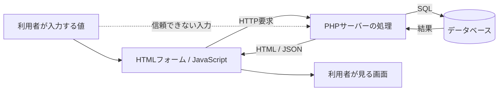

# Webアプリケーションの役割と信頼境界

この図は**概念図**です。サーバー・DBを起動する必要はありません。

| 境界 | 入るもの | 確認すべきこと |
|---|---|---|
| ブラウザ → PHP | GET/POST/JSON/Cookie | 入力検証、認証、CSRF、操作の意味 |
| PHP → DB | SELECT/UPDATE/INSERT | パラメータ化、最小権限、所有者チェック |
| DB → PHP | 行、NULL、件数 | 対象ユーザーの権限、例外とデータ型 |
| PHP/DB → HTML | 文字列 | コンテキスト別出力エンコード |
| PHP → ログ | エラーやID | 機密情報の除外、アクセス制御 |

## 読解の質問

「この値は誰が指定できる？」「この条件分岐は誰を信用している？」「このチェックを省くと誰のデータが返る？」「修正は入力／認証／認可／SQL／出力のどこに入る？」
